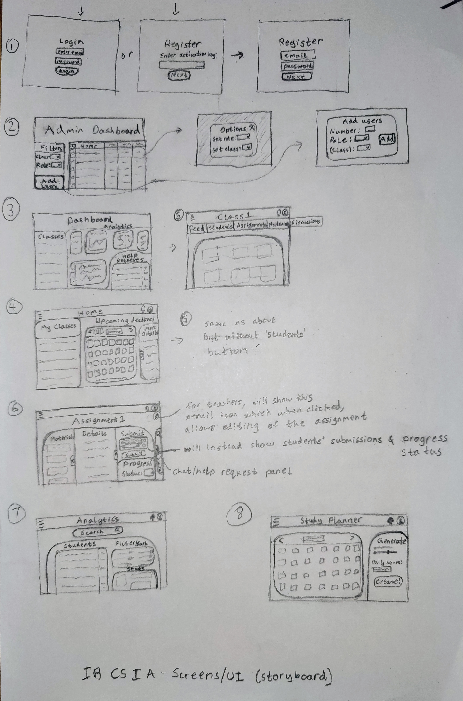
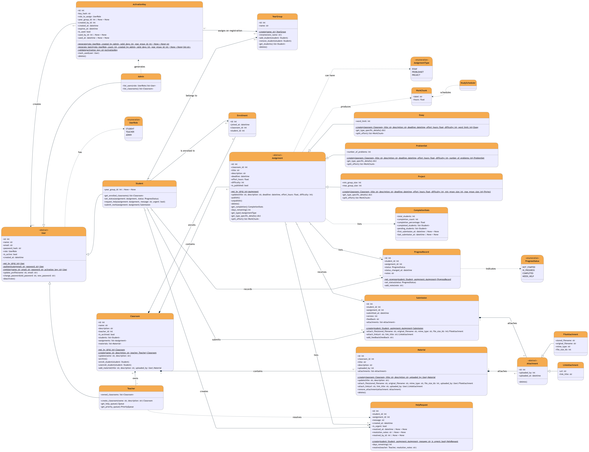
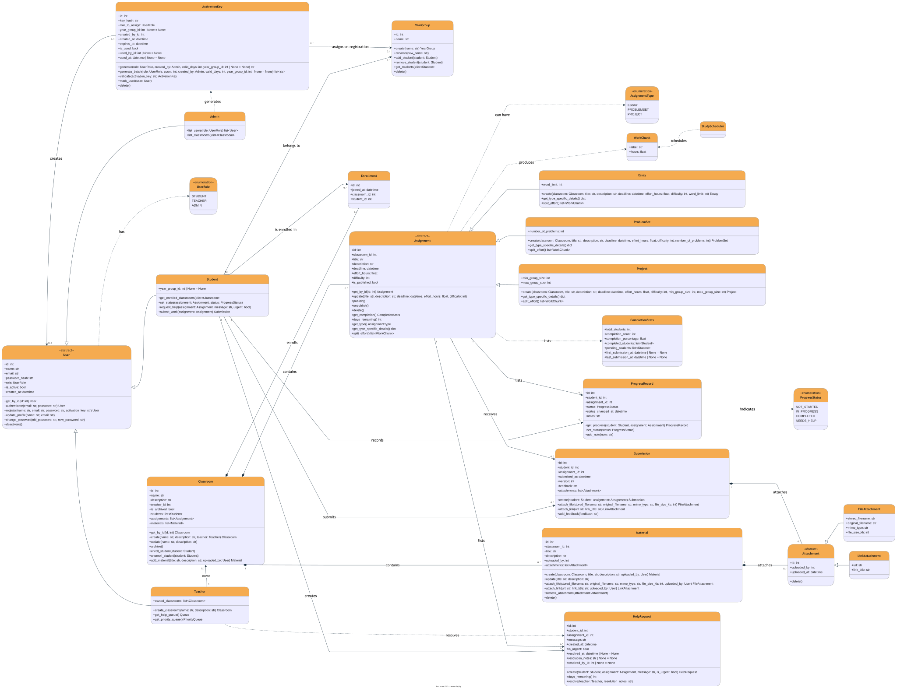
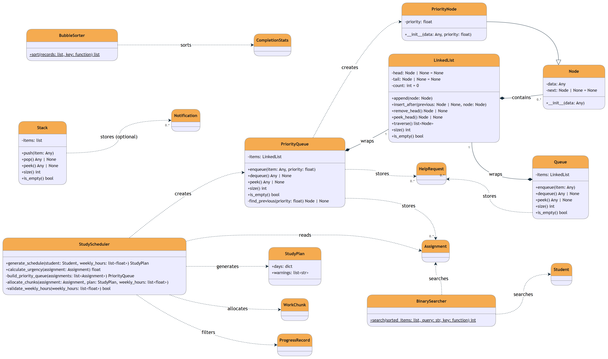
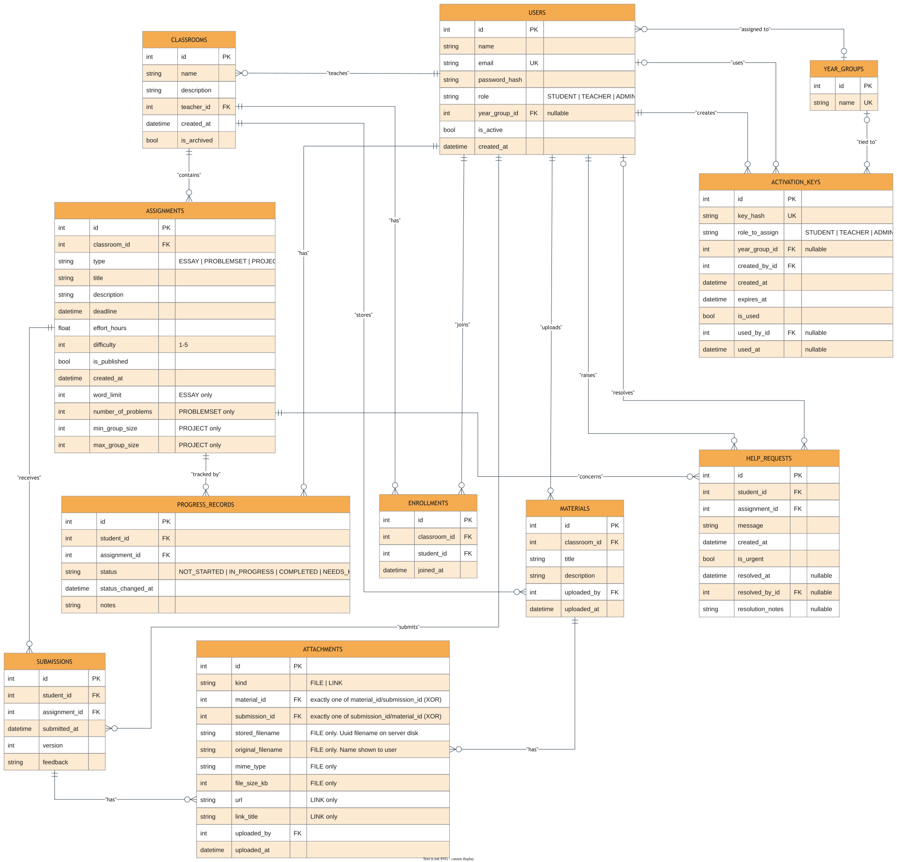

# SYSTEM OVERVIEW (Criterion C)

## UI

## UML

### Core UML
PNG:

SVG:

Mermaid code:
[Core UML Mermaid](UML/Core/CoreUML.mmd)

### ADT & Algorithms UML

PNG:

SVG:

Mermaid code:
[ADT & Algorithms UML Mermaid](UML/ADT/ADTUML.mmd)

## ERD

PNG:

SVG:

Mermaid code:
[ERD Mermaid](ERD/ERD.mmd)

## Algorithms

  [bulleted list with indentations (recommended); or pseudocode]

## Test plan

  [both 1. functional tests against success criteria and 1. correctness tests for major algorithms]
